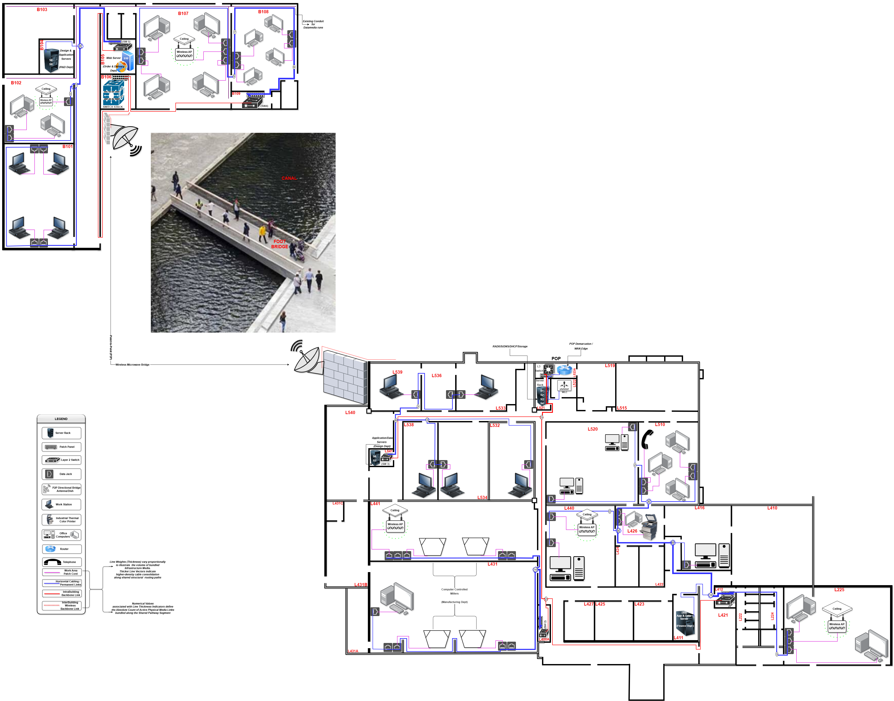
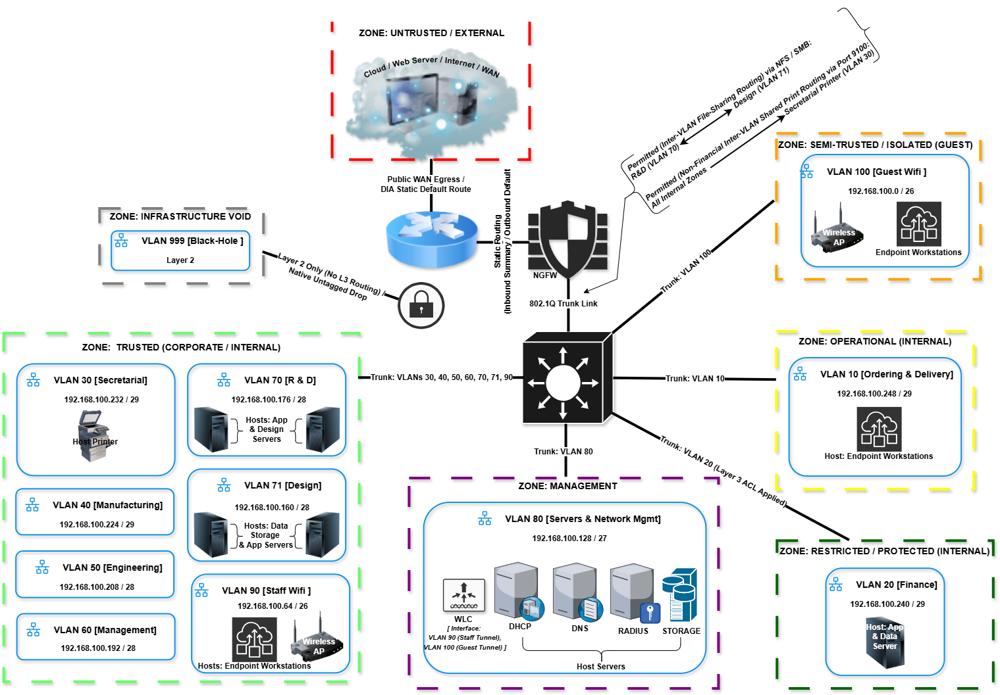

# Secure Enterprise Campus Network Redesign

## Table of Contents

* [Executive Summary &amp; Project Rationale](#executive-summary--project-rationale)
  * [Physical Layer Constraints &amp; Structural Challenges](#physical-layer-constraints--structural-challenges)
  * [Engineered Inter-Building Solution](#engineered-inter-building-solution)
* [Hierarchical Design &amp; Engineering Artifacts](#hierarchical-design--engineering-artifacts)
  * [Core Network Architecture Schematics](#core-network-architecture-schematics)
  * [VLSM Subnet Allocation Matrix](#vlsm-subnet-allocation-matrix)
  * [Host Asset Allocation Log](#host-asset-allocation-log)
  * [Security Architecture  Infrastructure Hardening](#security-architecture--infrastructure-hardening)
* [Compute Provisioning &amp; Server Architecture](#compute-provisioning--server-architecture)
* [Information Governance &amp; Portfolio Inquiries License](#information-governance--portfolio-inquiries)
  * [License](#license)

---

## Executive Summary & Project Rationale

This repository presents the comprehensive network engineering portfolio, logical zone layout, and security integration baselines designed for a corporate infrastructure modernization. The blueprint details the systematic transition of an unsegmented legacy computing layout characterized by isolated standalone endpoints and distributed dial-up lines into a secure, resilient, and multi-tiered hierarchical client-server network architecture.

### Physical Layer Constraints & Structural Challenges

The corporate campus encompasses two primary operational complexes which are separated geographically by a navigable canal. The project engineering parameters therefore introduced the following rigid implementation constraints:

* Physical subsurface or underwater cable path deployments across the canal are not feasible due to municipal and maritime regulations.
* Suspended rigid copper or fiber-optic wiring trunking along the adjacent swinging footbridge was structurally unrealistic, as kinetic movement, shifting structural distributions, and physical sheer stresses on the swinging structure would inevitably cause physical media fracturing.

### Engineered Inter-Building Solution

To circumvent these physical layer limitations, the inter-building transport infrastructure utilizes a high-throughput, over-the-air **Point-to-Point (PTP) Wireless Microwave Bridge**, operating over directional 5GHz radio arrays at a minimum capacity of **54 Mbps**. This transparent link connects both facilities without violating local environmental ordinances or exposing core assets to physical/environmental vulnerabilities.

---

## Hierarchical Design & Engineering Artifacts

The architecture migrates the enterprise away from flat network spaces to a **Hierarchical Collapsed Core switching topology**. This model mitigates lateral broadcast propagation, provides strict administrative boundary definitions, and optimizes intra-departmental routing.

### Core Network Architecture Schematics

* **Physical Layer Floor Plan Layout:** Maps physical endpoint distributions, structural drop conduits, server room coordinates, and cross-canal microwave antenna coordinates.
  
* **Logical Network Layer Topology:** Illustrates internal VLAN grouping perimeters, Layer 3 core routing targets, boundary blocks, and security domain classifications.
  

### VLSM Subnet Allocation Matrix

The assigned Class C IPv4 block (`192.168.100.0/24`) is partitioned using Variable Length Subnet Masking (VLSM) to maximize IP efficiency, with zero address space fragmentation.

|    VLAN ID    | Segment Name / Description | Network Address        |  CIDR  | Subnet Mask         | Wildcard     | Usable IP Range  | Default Gateway     | Usable Hosts | Allocation Justification                                            |
| :-----------: | :------------------------- | :--------------------- | :-----: | :------------------ | :----------- | :--------------- | :------------------ | :----------: | :------------------------------------------------------------------ |
| **100** | Guest Wireless             | `192.168.100.0`      | `/26` | `255.255.255.192` | `0.0.0.63` | `.1 – .62`    | `192.168.100.1`   |      62      | High transient turnover; broad range prevents pool exhaustion.      |
| **90** | Staff Wireless             | `192.168.100.64`     | `/26` | `255.255.255.192` | `0.0.0.63` | `.65 – .126`  | `192.168.100.65`  |      62      | Supports staff dual-devices (laptops/phones) + hire buffer.         |
| **80** | Infrastructure Mgmt        | `192.168.100.128`    | `/27` | `255.255.255.224` | `0.0.0.31` | `.129 – .158` | `192.168.100.129` |      30      | Static IPs for WLC, RADIUS, DNS, DHCP, and management SVIs.         |
| **71** | Design Dept                | `192.168.100.160`    | `/28` | `255.255.255.240` | `0.0.0.15` | `.161 – .174` | `192.168.100.161` |      14      | 5 CAD workstations + 2 file servers + expansion growth buffer.      |
| **70** | R & D Dept                 | `192.168.100.176`    | `/28` | `255.255.255.240` | `0.0.0.15` | `.177 – .190` | `192.168.100.177` |      14      | 4 engineering nodes + 2 local dedicated resource servers.           |
| **60** | Management Dept            | `192.168.100.192`    | `/28` | `255.255.255.240` | `0.0.0.15` | `.193 – .206` | `192.168.100.193` |      14      | Executive stations + video conferencing QoS endpoints.              |
| **50** | Engineering Dept           | `192.168.100.208`    | `/28` | `255.255.255.240` | `0.0.0.15` | `.209 – .222` | `192.168.100.209` |      14      | 8 Engineering endpoints distributed across the 2nd building complex |
| **40** | Manufacturing Dept         | `192.168.100.224`    | `/29` | `255.255.255.248` | `0.0.0.7`  | `.225 – .230` | `192.168.100.225` |      6      | 4 Networked CNC milling machines + maintenance access lanes.        |
| **30** | Secretarial Dept           | `192.168.100.232`    | `/29` | `255.255.255.248` | `0.0.0.7`  | `.233 – .238` | `192.168.100.233` |      6      | Administrative workstations + dedicated VoIP endpoint terminals.    |
| **20** | Finance Dept               | `192.168.100.240`    | `/29` | `255.255.255.248` | `0.0.0.7`  | `.241 – .246` | `192.168.100.241` |      6      | 2 Finance terminals + 1 Payroll Server. Isolated via ACLs.          |
| **10** | Ordering & Delivery        | `192.168.100.248`    | `/29` | `255.255.255.248` | `0.0.0.7`  | `.249 – .254` | `192.168.100.249` |      6      | Ordering terminals and barcode thermal printing hardware.           |
| **999** | Blackhole                  | `Layer 2 (Unrouted)` | `—` | `—`              | `—`       | `—`           | `None`            |      0      | Catchment for native untagged frames and disabled ports.            |

### Host Asset Allocation Log

Infrastructure assets and specialized server resources utilize static, deterministic IP definitions mapped directly from the front edge of their respective subnet blocks, while user endpoints pull dynamically from managed stateful DHCP pools:

| VLAN Segment           | Subnet / CIDR          | Host Classification / Role                                                                                                                                   |      Node Count      | Static IP Allocation                            | Managed DHCP Scope / Pool                                  | Buffer Range                |
| :--------------------- | :--------------------- | :----------------------------------------------------------------------------------------------------------------------------------------------------------- | :------------------: | :---------------------------------------------- | :--------------------------------------------------------- | :-------------------------- |
| **Edge Transit** | `10.0.0.0/30`        | WAN Edge Router / NGFW OutStateful Firewall Perimeter                                                                                                        |        1, 1        | `10.0.0.1 - 10.0.0.2`                         | *Static Link Routing**No Dynamic Allocation*             | *None*                    |
| **VLAN 100**     | `192.168.100.0/26`   | Public Guest Wi-Fi Gateway                                                                                                                                   |          1          | `192.168.100.1`                               | `192.168.100.10 – .62`                                  | `192.168.100.7 – .9`     |
| **VLAN 90**      | `192.168.100.64/26`  | Enterprise Staff Wi-Fi Gateway                                                                                                                               |          1          | `192.168.100.65`                              | `192.168.100.70 – .126`                                 | `192.168.100.67 – .69`   |
| **VLAN 80**      | `192.168.100.128/27` | Main L3 Core Switch,  SVI, Wireless LAN Controller (WLC), Central Core AAA Infrastructure, NGFW Internal, SVI Boundary, Lightweight Access Points (LAP1-5) | 1, 1, 1, 1, 1, 1, 5 | `192.168.100.129 - .134,  192.168.100.2 - .6` | *Static Infrastructure Block**No Dynamic Scopes Allowed* | `192.168.100.136 – .158` |
| **VLAN 71**      | `192.168.100.160/28` | Specialized CAD Storage Arrays                                                                                                                               |          2          | `192.168.100.162 - .163`                      | `192.168.100.164 – .174`                                | *Fully Assigned*          |
| **VLAN 70**      | `192.168.100.176/28` | R&D Local Resource Servers                                                                                                                                   |          2          | `192.168.100.178 - .179`                      | `192.168.100.180 – .190`                                | *Fully Assigned*          |
| **VLAN 60**      | `192.168.100.192/28` | Executive Boardroom QoS Nodes                                                                                                                                |          1          | `192.168.100.194`                             | `192.168.100.195 – .206`                                | *Fully Assigned*          |
| **VLAN 50**      | `192.168.100.208/28` | Work Station Nodes                                                                                                                                           |          1          | `192.168.100.210`                             | `192.168.100.211 – .222`                                | *Fully Assigned*          |
| **VLAN 40**      | `192.168.100.224/29` | Fanuc O1 CNC Controller Nodes                                                                                                                                |          4          | `192.168.100.226 - .229`                      | `192.168.100.230 Only`                                   | *Fully Assigned*          |
| **VLAN 30**      | `192.168.100.232/29` | Central Laser Printer Endpoint                                                                                                                               |          1          | `192.168.100.234`                             | `192.168.100.235 – .238`                                | *Fully Assigned*          |
| **VLAN 20**      | `192.168.100.240/29` | Isolated Secure Payroll Server                                                                                                                               |          1          | `192.168.100.242`                             | `192.168.100.243 – .246`                                | *Fully Assigned*          |
| **VLAN 10**      | `192.168.100.248/29` | Barcode Thermal Logistics Printer                                                                                                                            |          1          | `192.168.100.250`                             | `192.168.100.251 – .100.254`                            | *Fully Assigned*          |

***Note:** The Switchport Interface & Physical Connectivity Matrix detailing granular access-layer port assignments, endpoint cabling maps, and localized server dependency patch logs is omitted from this repository overview to optimize readability and maintain an in-depth architectural focus. The complete hardware connection matrices are fully maintained within the comprehensive technical documentation and are available upon request.*

### Security Architecture & Infrastructure Hardening

The defense-in-depth posture uses physical, Layer 2, and Layer 3 hardware boundaries to minimize the internal and perimeter threat vector by strategizing the following:

1. **Finance Dept. Isolation at Layer 3 (Network Segmentation):** Implemented contextual, extended Access Control Lists (ACLs) applied directly to the Core multi-layer engine, such that all non-financial packets attempting to cross the boundary into or out of the Finance segment are dropped at the hardware processing level by default.
2. **Switchport Infrastructure Hardening (VLAN 999):** Unused physical ports throughout empty corporate corridors and vacant facilities are bound to an unrouted Layer 2 BlackHole VLAN and further moved to an administrative shutdown state. This prevents Rogue Device Implants from achieving internal Link Layer access.
3. **Man-in-the-Middle (MitM) Mitigation:** Enforced DHCP Snooping globally to drop unauthorized rogue DHCP server advertisements, combined with Dynamic ARP Inspection (DAI) to validate incoming ARP frames against the trusted snooping binding ledger.
4. **MAC-Sticky Port Security:** Access switch links restrict node connectivity to an explicitly learned single MAC address using sticky learning profiles, executing immediate interface shutdown parameters upon detection of unauthorized network cards.
5. **Identity-Based Wireless Access Control:** Wireless authentication was migrated away from static, common pre-shared passwords to WPA2-Enterprise with 802.1X authentication while the wireless controllers proxy client authentication frames directly to a central RADIUS server for unique directory matching.
6. **Management Plane Cryptography:** Disabled all clear-text administrative access vectors (HTTP, Telnet) globally while device terminal operations are restricted exclusively to SSH (transport input ssh) utilizing salted, encrypted secret keys.

## Compute Provisioning & Server Architecture

Internal corporate storage, database nodes, identity management directories, and network daemons are consolidated onto dedicated hardware stacks hardware units located within the secure Main Distribution Frame (MDF), summarized below:
**Compute Assemblies:** Provisioned using enterprise Dell PowerEdge T350 Tower Server configurations running stable, licensing-compliant Windows Server 2022 Standard operating systems.
**Core Infrastructural Services:** Provides the foundational network environment, hosting centralized Active Directory-integrated DNS zone maps, automated stateful DHCP pools, and RADIUS AAA verification policies for network access control (802.1X).
**Secure WAN Edge:** Establishes the enterprise perimeter defenses, terminating external circuits via a resilient WAN Edge Router executing NAT/PAT translation engines. Inbound and outbound traffic is subjected to stateful packet inspection, deep packet inspection (DPI), and zone-based access control lists (ACLs) managed by an internal Next-Generation Firewall (NGFW).
**Hybrid E-Commerce Hosting Model:** To protect on-premise local office broadband links from saturation during business peak hours, the corporate public website is offloaded onto a cloud based infrastructure, and local order processing terminals pull resources directly over isolated internal lanes.

---

## Information Governance & Portfolio Inquiries

This README provides an in-depth technical overview of this project, including design deliverables, deployment analysis, and the network configuration framework.

If you are a recruiter, academic reviewer, or collaborator interested in evaluating the full technical brief, individual device baseline configuration snippets, explicit switchport matrices, or specific cross-VLAN printing exceptions, submit an inspection request directly through the profile communication channels of the **Project Lead & Network Architect** via:

* **LinkedIn:** [David Abhulimhen EBEGBETALE](https://www.linkedin.com/in/da-ebegbetale)

### License

This infrastructure design project is proprietary and confidential to the extent stated within the repository's standalone [LICENSE](./LICENSE) registry. The repository is public for portfolio review, academic evaluation, and architectural reference only. Refer to the linked license file for full terms.
